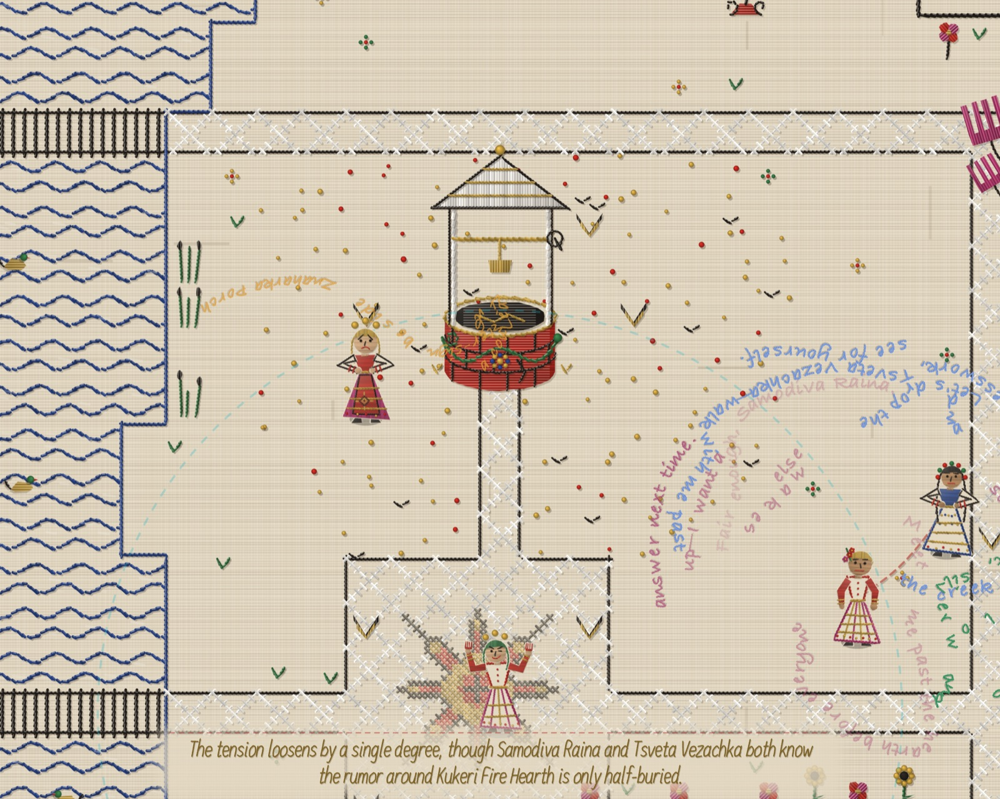

# seloai

**An environment for social simulation and emergent storytelling. A village brain plays every
character, an adaptive story engine paces and shapes what happens between them, and an adaptive
music engine scores it live, all in your browser. You bring the world and the people; you watch,
study and steer what emerges.**



**Try it: [languel.github.io/seloai](https://languel.github.io/seloai/)**. It runs in your browser,
nothing to install. Chrome or Edge works best.

## How it works

- **The village brain.** One AI model runs in your browser and plays every character. It
  decides what each one thinks and says, remembers what happened to them, and speaks with their
  voice. It also plays the Scribe, who narrates.
- **The adaptive story engine.** The story runs on a world clock you can pause, speed up or
  rewind. The engine decides who meets and talks and for how long, and what you tell a character
  changes what they do next.
- **The adaptive music engine.** A village band composes music live to the mood of the story,
  holds back when someone speaks, and follows your direction.

Seloai is a virtual village with nothing to win. You set up a situation, run it, see what
happened, change something and run it again. You can also build on it, for example a game, an
interactive piece, a simulation or a social experiment.

## Bring your own story

Make a place in the World Editor, people in Characters, and write the premise as a short story
file. Spinner, the assistant in the app, can help with any of it. **Help & Guides → Make your own
story** walks you through a first one.

The **Control Room** has tools for studying a run:

- **The Loom** shows the whole history as woven cloth. Characters are threads, each line is a
  stitch, and the music runs alongside, note by note.
- **Psychohistory** maps who is where, who is with whom and who is on whose mind.
- **The probe** marks a moment. Both views then show the world as it was at that moment, and you
  can ask the Scribe or Spinner about it.

## The demo

**Zmeyovo** is the default world. A village is in drought, a serpent has coiled around its well,
and six characters each want something different from the crisis. Use it as an example to copy or
take apart, or start from one of the other worlds in the menu.

## Getting started

1. Open the app and accept the **Voice + brain** model (about 1.5 GB, downloaded once).
2. Take the guided tour in **Help & Guides**.
3. Talk to anyone: `@Stoyan meet me at #Well`.

## Privacy

Everything runs and is saved in your browser. You can connect an online model with your own key
if you like. Keys stay in your browser and are left out of exported files.

## Run it yourself

```bash
pnpm install
```

```bash
pnpm dev
```

More: [developers](docs/DEVELOPERS.md) · [agents and MCP](docs/AGENTS.md) ·
[art direction](docs/ART_DIRECTION.md) · [handoff notes](HANDOFF.md)

## Acknowledgements

Seloai's first prototype started from [AI Town](https://github.com/a16z-infra/ai-town), which was
inspired by [*Generative Agents*](https://arxiv.org/abs/2304.03442). Seloai has since been rebuilt
from scratch for a different purpose, designing and studying your own simulations. The models are
LFM3 by Liquid AI and Kokoro by hexgrad, under their own licences.
