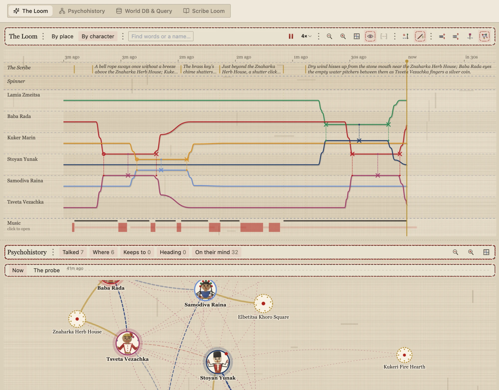

# seloai

**An environment for social simulation and emergent storytelling. A village brain plays every
character, an adaptive story engine paces and shapes what happens between them, and an adaptive
music engine scores it live, all in your browser. You bring the world and the people; you watch,
study and steer what emerges.**


**Try it: [languel.github.io/seloai](https://languel.github.io/seloai/)**. It runs in your browser,
nothing to install. Chrome or Edge works best.

## How it works

- **Village brain.** A single small model (about 2B parameters) runs on the GPU in your browser
  and plays every character. It decides what each one thinks and says, keeps their memories and
  speaks in their voice. It also plays the Scribe, the narrator. The preferred models are
  [Liquid AI](https://www.liquid.ai)'s LFM3, but you can bring your own, local (Ollama, LM Studio)
  or online with your own key.
- **Story engine.** The story runs on a world clock you can pause, speed up or rewind. The engine
  decides who meets, who talks and for how long, and turns what you say to a character into what
  they do next.
- **Music engine.** A three-piece folk band composes live from the mood of the story, in
  traditional modes and dance meters, and goes quiet when someone speaks.

Seloai is a virtual village with nothing to win. You set up a situation, run it, see what
happened, change something and run it again.

## Studying a run

The **Control Room** keeps the whole run:



- **The Loom** lays the history out as woven cloth. Characters are threads, each line is a stitch,
  and the music runs alongside, note by note.
- **Psychohistory** maps who is where, who is with whom and who is on whose mind.
- **The probe** marks a past moment. Both views show the world as it was then, and you can ask
  the Scribe or Spinner about it.

You can step in at any time, or place events ahead on the timeline ("in one minute, a storm").

## Making your own

Make a place in the World Editor, people in Characters, and write the premise as a short story
file. Spinner, the assistant in the app, can help with any of it, and **Help & Guides → Make your
own story** walks you through a first one. Other agents can build and drive worlds over MCP, and
the story engine can run headless from the command line with a fixed seed.

Seloai can also be the base for a game, an interactive piece, a simulation or a social
experiment.

## The demo

**Zmeyovo** is the default world. A village is in drought, a serpent has coiled around its well,
and six characters each want something different from the crisis. Use it as an example to copy or
take apart, or start from one of the other worlds in the menu.

## Getting started

1. Open the app and accept the **Voice + brain** model (about 1.5 GB, downloaded once).
2. Take the guided tour in **Help & Guides**.
3. Talk to anyone: `@Stoyan meet me at #Well`.

## Privacy

Everything runs and is saved in your browser. You can connect an online model with your own key
if you like. Keys stay in your browser and are left out of exported files.

## Run it yourself

```bash
pnpm install
```

```bash
pnpm dev
```

More: [developers](docs/DEVELOPERS.md) · [agents and MCP](docs/AGENTS.md) ·
[art direction](docs/ART_DIRECTION.md) · [handoff notes](HANDOFF.md)

## Acknowledgements

Seloai's first prototype started from [AI Town](https://github.com/a16z-infra/ai-town), which was
inspired by [*Generative Agents*](https://arxiv.org/abs/2304.03442). Seloai has since been rebuilt
from scratch for a different purpose, designing and studying your own simulations. The models are
LFM3 by [Liquid AI](https://www.liquid.ai) and Kokoro by hexgrad, under their own licences.
